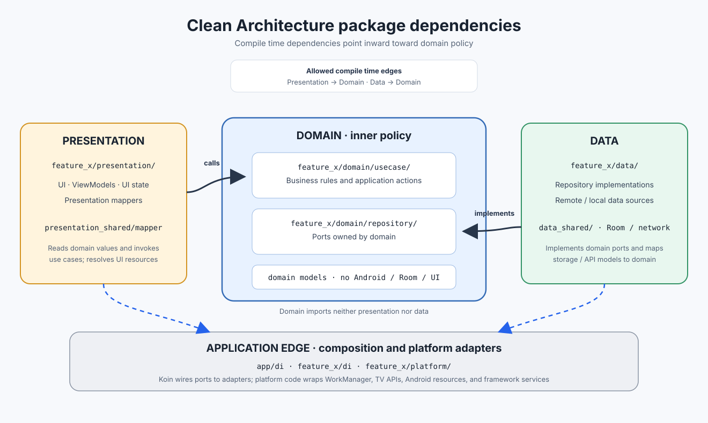

# Clean Architecture in BESTV

This guide describes the architecture implemented by the current BESTV packages. The project keeps its existing Gradle modules and organizes feature code into `presentation`, `domain`, `data`, `platform`, and `di` packages.



## Dependency rule

Source dependencies point inward toward domain policy:

- **Presentation depends on domain.** ViewModels invoke use cases and map domain values into presentation state.
- **Data depends on domain contracts.** Repository implementations implement interfaces owned by domain and return domain values. Data code also uses its outward details, such as Retrofit, Room, and `data_shared`.
- **Domain depends on neither presentation nor data.** It owns use cases, domain models, and repository interfaces. It does not import Android, Room, Retrofit, WorkManager, or UI models.
- **Platform adapters depend inward on domain contracts.** They wrap Android services and implement domain output ports where appropriate.
- **Dependency injection is the composition edge.** App and feature Koin modules know the concrete types and connect interfaces to implementations.

The dependency arrows describe compile-time references. At runtime, a use case calls a domain repository interface; the injected data or platform implementation performs the operation and returns domain values.

## Feature package layout

Feature folders follow this shape; individual features include only the packages they need:

```text
feature_search/
├── presentation/
│   ├── model/                 # Screen state, events, and effects
│   ├── viewmodel/
│   └── ui/                    # Activities and Compose screens
├── domain/
│   ├── *UseCase.kt
│   └── repository/            # Interfaces owned by domain
├── data/
│   ├── remote/api/
│   ├── remote/datasource/
│   └── repository/            # Implements domain interfaces
└── di/                        # Koin composition for this feature
```

Recommendation also has a `platform/` package for its boot receiver, WorkManager worker and scheduler, and Android TV providers. Keep platform-specific implementations at this outer edge rather than in domain.

## Shared packages and models

BESTV currently keeps shared types in existing Gradle modules:

```text
model_shared/
├── data/                      # API response and Room persistence models
├── domain/                    # WorkDomainModel, CastDomainModel, PageDomainModel,
│                              # ContentSource, and domain helpers
└── presentation/model/        # WorkViewModel, CastViewModel, PageViewModel, WorkType

data_shared/
└── local/                     # Room database, DAOs, and local data sources

presentation_shared/
└── presentation/
    ├── mapper/                # Shared domain-to-UI mappers
    ├── platform/              # Resource and other presentation services
    └── ui/                    # Shared Compose UI
```

`model_shared` contains types from several layers because the project is not adding Gradle modules for this refactor. Imports still follow the package boundaries, and `verifyArchitecture` checks selected prohibited imports. This gives useful source-level protection, while Gradle does not enforce those subpackages as independent compile-time modules.

## Mapping rules

### API and persistence models to domain

Data mappers return resource-free domain values. For work and cast values, the data mapper assigns `ContentSource.TMDB`; it does not read Android strings or import `presentation_shared`.

```kotlin
// model_shared/data/mapper/WorkResponseMapper.kt
fun WorkResponse.toDomainModel(): WorkDomainModel = WorkDomainModel(
    id = id,
    source = ContentSource.TMDB,
    // Map API fields and determine the domain work type.
)
```

Repository implementations call these mappers after fetching API responses. Local data sources encapsulate DAOs and Room entities.

### Domain values to UI models

Shared UI mappers live in `presentation_shared` and accept `Resource` when the mapping needs a localized label. The mapper resolves `ContentSource.TMDB` to the existing “TMDb” string. Feature-specific UI mappings stay in that feature's `presentation/mapper` package.

```kotlin
// presentation_shared/presentation/mapper/WorkViewModelMapper.kt
fun WorkDomainModel.toViewModel(resource: Resource): WorkViewModel?
```

Do not put UI-to-Room mappers in presentation. For Work Details favorites, the domain operation receives a work ID, `WorkDomainModel.Type`, and desired favorite state. The data repository creates `MovieDbModel` or `TvShowDbModel` inside the data boundary.

## Repository ports and dependency injection

Each feature owns repository interfaces under `domain/repository`. Use cases depend on those interfaces, not on implementation classes. The feature's Koin module binds the port to the data implementation:

```text
feature_search/domain/repository/MovieRepository
                 ▲
                 │ implemented by
feature_search/data/repository/MovieRepository
```

Koin modules may import domain, data, presentation, and platform types because they compose the application. Keep these cross-package references in `di` rather than moving them into domain or presentation business code.

Most features bind their domain repository ports to repositories in `data`. Recommendation has two different ports:

- Its movie input port is implemented in `data`.
- Its recommendation output port is implemented directly by an Android TV provider in `platform`.

The Work Details, Browse, Search, and Cast Details modules follow the regular domain-port-to-data-repository pattern. See [KOIN_DI.md](KOIN_DI.md) for module registration and binding details.

## Example request flow

Search illustrates the runtime flow and the compile-time boundaries:

```text
Search Compose UI
    → SearchViewModel
    → Search use case
    → domain MovieRepository interface
    → data MovieRepository implementation
    → remote data source / Retrofit API
    → TMDb

TMDb response
    → data mapper
    → WorkDomainModel / PageDomainModel
    → SearchViewModel
    → presentation_shared mapper + Resource
    → UI state and screen
```

The arrows in this request flow show calls and returned data. They do not mean that domain imports data: the use case calls an interface declared in domain, and Koin supplies the concrete implementation at runtime.

## Recommendation platform work

The boot receiver calls `RecommendationScheduler` in `platform`. The scheduler enqueues a unique hourly periodic request with `ExistingPeriodicWorkPolicy.KEEP`, so repeated boot broadcasts retain an existing schedule. During migration it cancels requests carrying the legacy `RECOMMENDATION` tag; the new request does not use that tag.

`RecommendationWorker` invokes the domain use case. It propagates coroutine cancellation, retries recoverable I/O errors and HTTP 429/5xx responses, and returns failure for other errors. The TV provider updates a saved preview program using its stored program ID and inserts a replacement when that ID is stale.

## Architecture checks

Run the root Gradle task:

```shell
./gradlew verifyArchitecture
```

`:app:preBuild` depends on this task. It scans production Kotlin imports and currently rejects:

- Domain imports from data, presentation, Android/AndroidX, Retrofit, or Koin.
- Data imports from presentation.
- Persistence imports from `model_shared/presentation`.
- Direct imports from another feature package.

Platform adapters and feature DI are allowed to form the composition edge. The check is a source import guard, not a substitute for Gradle module boundaries or code review; keep presentation free of data imports as well, even though a separate presentation-to-data rule is not currently enforced by this task.

## Practices for new code

- Define a domain repository interface when a use case needs an external capability; implement it in data or a platform adapter.
- Keep domain models independent of API, database, Android resource, and UI types.
- Map API and persistence types into domain in the outer data layer.
- Map domain values into screen-specific models in presentation.
- Express commands as requested outcomes where practical, such as setting a favorite state to `true` or `false`.
- Keep framework scheduling, receivers, providers, and service APIs in platform adapters.
- Wire implementations in Koin modules at the composition edge.
- Add or update tests at the layer whose behavior changed, including repository bindings and adapter behavior where relevant.
