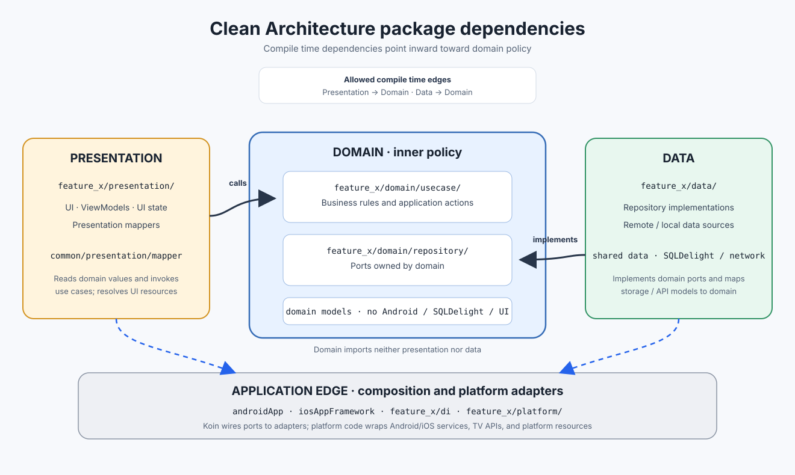

# Clean Architecture in BESTV

This guide describes the architecture implemented by the current BESTV modules and source sets. Feature code is organized into `presentation`, `domain`, `data`, `platform`, and `di` packages. The `common` module and mobile feature modules have Android and iOS Kotlin Multiplatform targets. Portable data and domain code, shared ViewModels, route contracts and UI primitives live in `commonMain`, while shared mobile screens live in `mobileMain`; Android-specific drivers, resource adapters, Intent navigation, and TV UI live in Android source sets. The `appComposition` module aggregates shared app-level Koin bindings for Android and iOS, while `iosAppFramework` provides the iOS Compose entry point and framework. Each feature owns its typed Ktor TMDb API client.



## Dependency rule

Source dependencies point inward toward domain policy:

- **Presentation depends on domain.** ViewModels invoke use cases and map domain values into shared presentation state; platform resource lookup stays behind presentation contracts.
- **Data depends on domain contracts.** Repository implementations implement interfaces owned by domain and return domain values. Data code also uses its outward details, such as Ktor, SQLDelight, and shared data models.
- **Domain depends on neither presentation nor data.** It owns use cases, domain models, and repository interfaces. It does not import Android, SQLDelight, Ktor, WorkManager, Koin, or UI models.
- **Platform adapters depend inward on domain contracts.** They wrap platform services, such as Android workers or iOS APIs, and implement domain output ports where appropriate.
- **Dependency injection is the composition edge.** App and feature Koin modules know the concrete types and connect interfaces to implementations.

The dependency arrows describe compile-time references. At runtime, a use case calls a domain repository interface; the injected data or platform implementation performs the operation and returns domain values.

## Feature package layout

Feature folders follow this shape; individual features include only the packages they need:

```text
feature_search/src/commonMain/kotlin/com/pimenta/bestv/search/
├── presentation/
│   ├── model/                 # Screen state, events, and effects
│   ├── navigation/            # Shared entry-provider builder
│   └── viewmodel/
├── domain/
│   ├── *UseCase.kt
│   └── repository/            # Interfaces owned by domain
├── data/
│   ├── remote/api/
│   ├── remote/datasource/
│   └── repository/            # Implements domain interfaces
└── di/                        # Koin composition for this feature

feature_search/src/mobileMain/kotlin/ # Shared Android mobile and iOS screens
feature_search/src/androidMobile/ # Mobile wrapper
feature_search/src/androidTV/     # TV wrapper and screens
```

The KMP features place shared layers in `src/commonMain/kotlin` and shared strings/images in `src/commonMain/composeResources`; shared fonts can use the same resource source set when added. Navigation entry providers are shared; Android wrappers and TV screens live in the flavored source directories of each feature. `mobileMain` is a directory registered with both `iosMain` and the Android mobile compilation, not a separate Gradle module. The Android TV compilation does not include those mobile feature screens. The `feature_recommendation` module remains Android-only and has a `platform/` package for its boot receiver, WorkManager worker and scheduler, and Android TV providers. It is currently included in both Android flavors. Keep platform-specific implementations at this outer edge rather than in domain.

## Shared packages and models

BESTV separates portable local persistence from Android-specific shared infrastructure. Existing Kotlin package names remain grouped by responsibility under `com.pimenta.bestv`:

```text
common/src/commonMain/kotlin/com/pimenta/bestv/
├── config/                    # Portable application constants
├── data/remote/api/           # Shared Ktor client configuration
├── data/remote/model/         # Shared TMDb response DTOs
├── data/remote/mapper/        # Shared response-to-domain mappers
├── data/local/                # SQLDelight persistence models and data sources
├── di/                        # Shared database/network bindings and dispatcher module
├── domain/                    # Domain models and coroutine helpers
└── presentation/
    ├── extension/             # Portable presentation extensions
    ├── mapper/                # Domain-to-view-model and image URL mapping
    ├── model/                 # Serializable presentation models and pagination
    ├── platform/              # Shared presentation contracts
    ├── route/                 # Shared destination keys and route contracts
    ├── theme/                 # Shared Compose Multiplatform theme
    ├── ui/compose/            # Shared mobile UI primitives
    └── viewmodel/             # Lifecycle Multiplatform BaseViewModel

common/src/androidMain/kotlin/com/pimenta/bestv/
├── data/remote/api/           # Android OkHttp client engine
├── di/                        # Android SQLDelight driver and presentation DI
├── platform/                  # Android formatting implementation
└── presentation/
    ├── image/                 # Android image-loader configuration
    ├── platform/              # Android resource adapter
    └── route/                 # Android Intent route adapters and route DI

common/src/androidTV/  # Android TV Compose theme and primitives

common/src/iosMain/kotlin/com/pimenta/bestv/
├── logging/                    # iOS logger implementation
└── platform/                   # iOS formatting implementation

common/src/commonMain/sqldelight/com/pimenta/bestv/data/local/database/
└── *.sq                       # Portable SQLite schema and typed queries

feature_<capability>/data/local/
└── mapper/                    # Persistence model to domain mapping

appComposition/src/commonMain/ # Shared app-level Koin composition for Android and iOS
androidApp/src/main/            # Android Application, Activity, and Navigation 3 host
iosApp/                         # SwiftUI/Xcode app and native entry point
iosAppFramework/src/commonMain/ # iOS Compose app renderer over shared feature screens
iosAppFramework/src/iosMain/    # ComposeUIViewController and iOS Koin/driver/engine bindings
```

The `common` Android target has the generated resource namespace `com.pimenta.bestv.common.R`; Android-only resources live under `common/src/androidMain/res`, while shared assets and strings use Compose resources in `commonMain`. Portable application constants, Koin bindings, TMDb DTOs, presentation models, domain-to-presentation mappers, route contracts, and SQLDelight query APIs are in `commonMain`. Android-specific code includes the Koin SQLDelight driver, resource adapter, OkHttp engine, Intent routes, and Android image-loader setup. Mobile screen implementations are in each feature’s `mobileMain`; Android TV screens and wrappers are in the features’ `androidTV` source sets. The `androidApp` module owns `BuildConfig`, app startup, and the Android Navigation 3 host. Typed endpoint clients and feature-specific response models stay in their feature's `data/remote` package. The shared SQLDelight schema, persistence models, and local database operations live in `common`; Android creates its SQLDelight driver in `common`'s Android driver DI module.

## Mapping rules

### API and persistence models to domain

Data mappers return resource-free domain values. Keep shared API response models and mappers under `common/src/commonMain/kotlin/.../data/remote`; persistence model mappers stay in the owning feature's `data/local/mapper`. For work and cast values, the data mapper assigns `ContentSource.TMDB`; it does not read Android strings or import presentation code.

```kotlin
// common/src/commonMain/kotlin/com/pimenta/bestv/data/remote/mapper/WorkResponseMapper.kt
fun WorkResponse.toDomainModel(): WorkDomainModel = WorkDomainModel(
    id = id,
    source = ContentSource.TMDB,
    // Map API fields and determine the domain work type.
)
```

Repository implementations call API mappers after fetching responses. Feature repositories use shared SQLDelight local data sources and feature mappers to convert persistence models into domain values. Keep the SQLite schema, generated queries, persistence models, and shared local data sources in `common`; keep domain mapping with the feature that owns the domain type.

### Domain values to UI models

The image URL builder and shared domain-to-view-model mappers live in `commonMain/presentation/mapper`. They receive the portable `ContentSourceLabelProvider` contract; Android's `Resource` adapter and the iOS binding provide platform-specific labels. Feature-specific UI mappings stay in that feature's `presentation/mapper` package.

```kotlin
// common/src/commonMain/kotlin/com/pimenta/bestv/presentation/mapper/WorkViewModelMapper.kt
fun WorkDomainModel.toViewModel(contentSourceLabelProvider: ContentSourceLabelProvider): WorkViewModel?
```

Do not put UI-to-database mappers in presentation. For Work Details favorites, the domain operation receives a work ID, `WorkDomainModel.Type`, and desired favorite state. The data repository creates a `MovieDbModel` or `TvShowDbModel` inside the data boundary.

## Repository ports and dependency injection

Each feature owns repository interfaces under `domain/repository`. Use cases depend on those interfaces, not on implementation classes. A feature's Koin module in `commonMain` binds its port to the data implementation:

```text
feature_search/domain/repository/MovieRepository
                 ▲
                 │ implemented by
feature_search/data/repository/MovieRepository
```

Koin modules may import domain, data, presentation, and platform types because they compose the application. Keep these cross-package references in `di` rather than moving them into domain or presentation business code.

Most features bind their domain repository ports to repositories in `data`. Recommendation has two different ports:

- Its movie input port is implemented in `data`.
- Its recommendation output port is implemented directly by an Android TV provider in `platform`.

The Work Details, Browse, Search, and Cast Details Koin modules live in `commonMain` and follow the regular domain-port-to-data-repository pattern. Recommendation remains Android-only. See [KOIN_DI.md](KOIN_DI.md) for each platform's composition root and binding details.

## Shared UI and platform adapters

The mobile Browse, Search, Work Details, and Cast Details composables live in their feature modules’ `mobileMain` source directories and are used by both Android and iOS. Their ViewModels, state, events, and effects are shared as well. Android keeps the TV-specific screens, focus behavior, Navigation 3 `NavDisplay` host, and Intent adapters in Android source sets and `androidApp`. iOS uses the SwiftUI target in `iosApp` and the Kotlin `iosAppFramework` module, which renders the same mobile screens and handles iOS startup, back navigation, deep links, and platform callbacks. Shared effects carry route keys or URL strings rather than Android `Intent` objects.

The feature entry-provider functions in `commonMain` take screen content from the host. The Android navigation module supplies identically named wrappers from either `androidMobile` or `androidTV`; the iOS navigation module supplies the mobile screens. Android chooses the wrapper through the build variant, while `BuildConfig.IS_MOBILE` selects the host's navigation transition behavior.

## Example request flow

Search illustrates the runtime flow and the compile-time boundaries:

```text
Search Compose UI
    → SearchViewModel
    → Search use case
    → domain MovieRepository interface
    → data MovieRepository implementation
    → remote data source / Ktor API client
    → TMDb

TMDb response
    → data mapper
    → WorkDomainModel / PageDomainModel
    → SearchViewModel
    → common/presentation mapper + ContentSourceLabelProvider
    → UI state and screen
```

The arrows in this request flow show calls and returned data. They do not mean that domain imports data: the use case calls an interface declared in domain, and Koin supplies the concrete implementation at runtime.

## Recommendation platform work

The boot receiver calls `RecommendationScheduler` in `platform`. The scheduler enqueues a unique hourly periodic request with `ExistingPeriodicWorkPolicy.KEEP`, so repeated boot broadcasts retain an existing schedule. During migration it cancels requests carrying the legacy `RECOMMENDATION` tag; the new request does not use that tag.

`RecommendationWorker` invokes the domain use case. It propagates coroutine cancellation, retries recoverable I/O errors and HTTP 429/5xx responses, and returns failure for other errors. The TV provider updates a saved preview program using its stored program ID and inserts a replacement when that ID is stale.

## Architecture checks

Run the root Gradle task:

```shell
./gradlew verifyArchitecture
```

`:androidApp:preBuild` depends on this task. It scans production Kotlin imports and currently rejects:

- Domain imports from data, presentation, Android/AndroidX, Ktor, or Koin.
- Data imports from presentation.
- Data imports from common presentation packages and presentation imports from data.
- Direct imports from another feature package.

The scan includes `commonMain`, `androidMain`, `androidMobile`, `androidTV`, `mobileMain`, `iosMain`, `jvmMain`, and Android `main` Kotlin/Java source directories. It does not inspect generated or test sources or enforce Gradle dependency declarations.

Platform adapters and feature DI are allowed to form the composition edge. The check is a source import guard, not a substitute for Gradle module boundaries or code review.

## Practices for new code

- Define a domain repository interface when a use case needs an external capability; implement it in data or a platform adapter.
- Keep domain models independent of API, database, Android resource, and UI types.
- Map API and persistence types into domain in the outer data layer.
- Map domain values into screen-specific models in presentation.
- Express commands as requested outcomes where practical, such as setting a favorite state to `true` or `false`.
- Keep framework scheduling, receivers, providers, and service APIs in platform adapters.
- Wire implementations in Koin modules at the composition edge.
- Add or update tests at the layer whose behavior changed, including repository bindings and adapter behavior where relevant.
